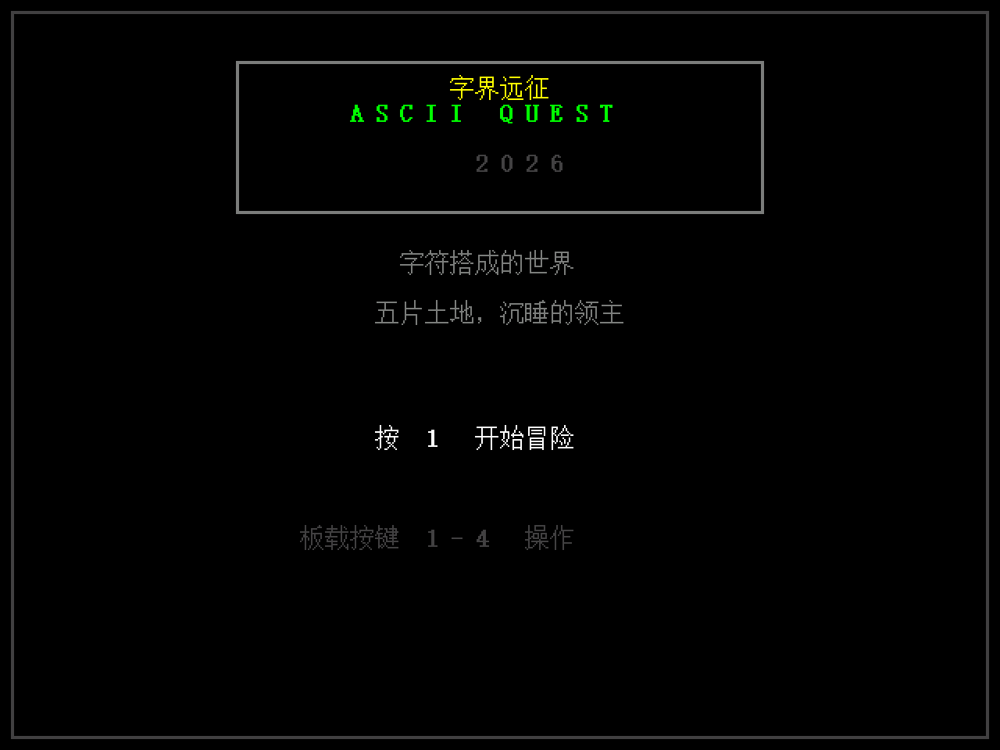
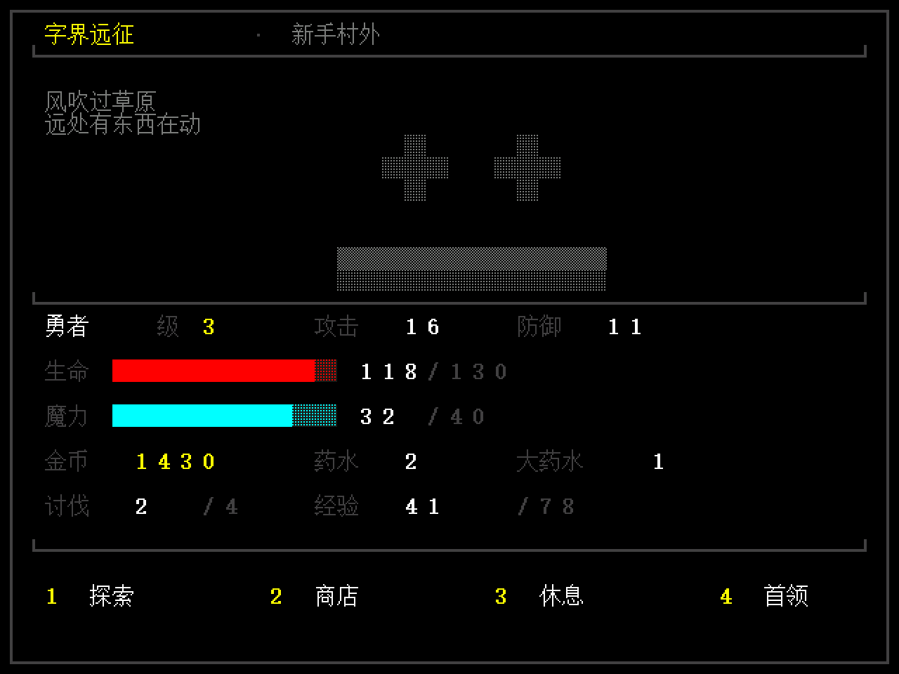
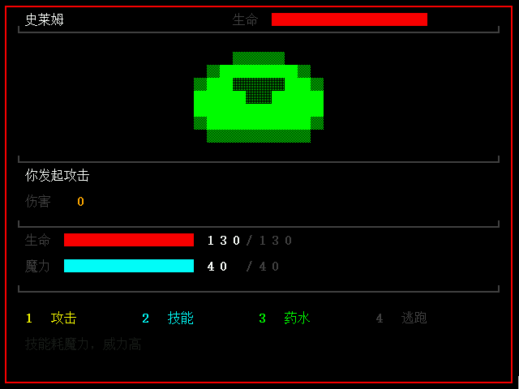

# 字界远征 · ASCII Quest

**在安路 EG4S20 上用纯 HDL 实现的字符界面回合制 RPG。没有 CPU、没有软核、没有 SDRAM，
HDMI 直接输出 640×480 画面，板载 4 个按键操作。**

<table>
<tr>
<td align="center"><br><sub>标题</sub></td>
<td align="center"><br><sub>地图</sub></td>
<td align="center"><br><sub>战斗</sub></td>
</tr>
</table>

---

## 一、这是什么

一个能直接插显示器玩的完整游戏，跑在一块 2 万门级别的 FPGA 上：

- **5 个区域、15 种怪物、3 个职业**，回合制战斗，等级成长、商店、药水、首领战
- **40 列 × 30 行**字符屏，每格 16×16 点阵，**252 个字形**的中文点阵字库
- 所有怪物用方块字符（`█▓░`）画成 12×9 的像素图，没有一张位图资源
- 界面由**指令表 + 解释器**驱动：排版全部在 Python 生成器里，改一个字不用碰 Verilog
- 断点续不了（没有掉电存储），但也不需要——字符游戏本来就是开机重来

数值设计：只用普攻打不动硬怪，必须在有蓝时用技能（剑士重斩无视 40% 护甲、
法师火球无视 60%、游侠三连射）。这条是仿真调出来的。

---

## 二、硬件平台

| 项 | 值 |
|---|---|
| 器件 | 安路 EG4S20（HX4S20C 开发板）|
| 显示 | HDMI，640×480p60（CEA-861 480p）|
| 输入 | 板载 4 个独立按键（KEY1~KEY4）|
| 时钟 | 50MHz 有源晶振 + 片内 PLL |
| 外部存储 | **不使用** |

不需要外部存储是这套设计最关键的一点，理由见文末「设计取舍」。

---

## 三、架构

```
 按键 x4 ──► 消抖 ──►┌──────────────┐
                     │  rpg_core    │  游戏状态机 + 指令解释器
                     │              │  （伤害/成长/商店/战斗流程）
                     └──┬───────────┘
                        │ 写格子 {bg,fg,glyph} = 16bit
                        ▼
                  ┌──────────────┐        ┌──────────┐
                  │  rpg_video   │◄───────┤ font_rom │ 16×16 点阵
                  │ 40×30 字符屏 │        └──────────┘
                  └──┬───────────┘
                     │ rgb565 + de/hs/vs
                     ▼
                  ┌──────────────┐      ┌──────────────┐
                  │   hdmi_tx    │◄─────┤ cmd/str/art  │ 界面指令
                  │ TMDS 编码    │      │    ROM       │ 文案 / 精灵
                  └──┬───────────┘      └──────────────┘
                     ▼
              HDMI 3 数据对 + 1 时钟对
```

| 模块 | 职责 |
|---|---|
| `ctrl/rpg_core.v` | 游戏全部逻辑 + 界面指令解释器（最核心）|
| `video/rpg_video.v` | 字符屏渲染：格子 → 字模 → rgb565 |
| `video/vid_timing.v` | 480p 时序 |
| `video/tmds_encoder.v` / `tmds_serdes.v` / `hdmi_tx.v` | TMDS 8b/10b 与 HDMI 封装 |
| `gen/ui_rom.v` | 由脚本生成的 4 个 ROM 与数据表 |

**只用两个时钟**：25.175MHz 像素时钟（所有逻辑都跑在这里）和 125.875MHz
（只给 TMDS 串行化用）。没有异步跨时钟域。

---

## 四、屏幕规格

| 项 | 值 |
|---|---|
| 分辨率 | 640×480 @60Hz |
| 像素时钟 | 25.175 MHz |
| 字符网格 | 40 列 × 30 行 |
| 每格 | 16×16 像素，16bit = `{bg[3:0], fg[3:0], glyph[7:0]}` |
| 字库 | 252 个字形（中文 + ASCII + 自绘边框图元）|
| 调色板 | 16 色（RGB565）|
| 整屏占用 | 1200 × 16bit = **2.4KB** |

两个容易被忽略的细节：

- **ASCII 在字库里就被横向放大了一倍**。中文是 16×16 满格，系统字体里的 ASCII
  只有 8 宽，不放大就会出现「H P　1 2 0」这种拉开的字距。
- **边框不是用字体的制表符画的**。实测宋体 16px 下 `┌─│` 只画了四分之一格，
  拼出来的框是断的。所以框线、方块、进度条都是 `build_rom.py` 里用像素点出来的图元。

---

## 五、目录

```
├── rtl/
│   ├── rpg_top.v              顶层
│   ├── clk_gen.v              PLL 封装（综合时定义 USE_PLL_IP）
│   ├── ctrl/rpg_core.v        ★ 游戏逻辑 + 界面解释器
│   ├── video/                 字符屏 / 480p 时序 / TMDS
│   ├── common/                复位、按键消抖
│   └── gen/                   脚本生成：4 个 hex + 3 个 .v/.vh
├── tools/
│   ├── build_rom.py           ★ 所有文案、数值、精灵、排版都在这里
│   ├── gdi_font.py            用 Windows GDI 把字栅格化成 16×16
│   └── rgb2png.py             仿真导出的原始像素 → PNG
├── sim/iverilog/              Icarus Verilog 测试台（跑真实 RTL，直接出画面）
├── preview/                   界面预览图（生成的 + 仿真实拍的）
└── constraints/
    ├── rpg_pins.adc           引脚约束（★ 要按原理图改）
    └── timing.sdc             时序约束
```

---

## 六、改内容不用碰 Verilog

文案、怪物数值、精灵图、界面排版全在 `tools/build_rom.py` 顶部：

```python
ENEMIES = [("史莱姆", 36, 8, 2, 9, 7, 0, 0), ...]   # 名字 hp atk def exp gold 精灵号 是否BOSS
AREAS   = [("新手村外", [0, 1], 10), ...]           # 区域名 两只小怪 首领索引
SPRITES = {0: ["    ▓▓▓▓    ", ...]}                # 方块画的精灵，12x9

def screen_battle():                                # 界面排版
    o += S(2, 1, "生命", GRAY)                       # S(x, y, 文字, 颜色)
```

改完跑一次：

```bash
python tools/build_rom.py
```

它会重新生成字库 / 指令表 / 字符串 / 精灵，**同时把每个界面渲染成
`preview/*.png`**——不上板就能确认排版对不对，这一步能省掉大量调试时间。

> 字形总数上限 255（`0xFF` 是字符串结束符）。超了脚本会直接报错并打印当前用到的
> 全部汉字，照着删几个字就行。

---

## 七、仿真

板子没到也能跑。用 **Icarus Verilog**（免费开源），它跑的是真实 RTL。

### 装

| 平台 | 方式 |
|---|---|
| Windows | http://bleyer.org/icarus/ → `iverilog-v12-x64_setup.exe` |
| macOS | `brew install icarus-verilog` |
| Ubuntu | `sudo apt install iverilog` |

Windows 安装时勾选 "Add to PATH"，新开终端 `iverilog -V` 能出版本号即可。
同包装里自带 **GTKWave**，想看波形用得上。

### 跑

```bat
sim\iverilog\run.bat
```

（Linux/macOS：`./sim/iverilog/run.sh`）

编译 → 仿真 → 把像素转成 PNG，输出在 `preview/sim/frame_01.png`……
**一张图对应一次按键**。实测 19 次按键约 2 分半。

测试台不导 VCD，而是直接用 `$fwrite` 把帧缓冲写成原始 RGB888，
比「跑完再解析上百 MB 波形」快得多。

> **务必在工程根目录跑**。RTL 里的 `$readmemh("rtl/gen/font.hex", …)` 是相对路径，
> 换目录会读不到字库，现象是满屏只剩边框没有字。

### 自己玩

终端仿真器读不了键盘，所以按键改成脚本 `sim/iverilog/keys.txt`，一行一个键（1~4）：

```
1   标题页按 KEY1 → 选职业
1   按 KEY1 选剑士 → 地图
1   地图上 KEY1 = 探索，进入战斗
1   战斗里 KEY1 = 攻击
1   敌人死了就回地图，再按 KEY1 又是探索……
4   讨伐满 4 只后按 KEY4 挑战首领
```

**一路按 1 就能自动打下去**——战斗里 KEY1 是攻击，地图上是探索，敌人一死自动回地图。
示例脚本是 `1 1` + 16 个 `1` + `4`，正好打进第一个首领。

---

## 八、上板与烧录

完整的建工程、生成 PLL、生成码流、下载到 SRAM / Flash 的步骤，以及
「烧完没画面怎么排查」，单独写在 **[docs/上板与烧录.md](docs/上板与烧录.md)**。

> **只要两个编译宏**：`USE_PLL_IP`（用 TD 生成的 PLL）和 `USE_ODDR_PRIM`
> （TMDS 用 IO 的 DDR 原语而不是 LUT）。少第二个的直接症状就是整屏竖条纹。
> PLL 和引脚已按 HX4S20C 填好，不用再改。

下面是其中几件容易踩坑的：


### 1. PLL 与 DDR 原语（两个宏）

`rtl/clk_gen.v` 里 PLL 已经接好（50MHz → 25MHz + 125MHz），
只要用 TD 的 IP Generator 生成一个叫 `pll_ip` 的 PLL，综合时定义 `USE_PLL_IP`。

`rtl/video/tmds_serdes.v` 的 DDR 输出必须定义 `USE_ODDR_PRIM`，
否则会退化成 LUT 搭的 DDR，125MHz 下**必然出现整屏竖条纹**。

两个宏都不定义时，`clk_gen` 会故意例化一个不存在的模块逼综合报错——
防止忘了配就烧板，黑屏还查不出原因。

### 2. 引脚

`constraints/rpg_pins.adc` 已按 HX4S20C 填好（含 4×4 矩阵键盘的 `key_row[3:0]`）。
换板子才需要改：HDMI 那 4 对必须在支持 LVDS 的差分对上，P/N 同组，TD 只约束 P 端。

### 3. hex 文件路径

4 个 ROM 用 `$readmemh("rtl/gen/xxx.hex", mem)` 初始化。TD 的工作目录是工程根目录，
所以要么保持这个相对路径，要么把 `rtl/gen` 加进搜索路径。
**路径不对的表现是所有文字消失、只剩边框**——这是最快的排查信号。

### 4. TMDS 串行化

`tmds_serdes.v` 在没定义 `USE_ODDR_PRIM` 时是行为模型（只能仿真）。
上板要接安路的 DDR 输出原语，或者直接用 TD 的 LVDS/SerDes IP 替换输出级。
480p 时串行率只有 251.75Mbps，比 720p 好做得多。

---

## 九、操作

| 界面 | 1 | 2 | 3 | 4 |
|---|---|---|---|---|
| 标题 | 开始 | | | |
| 选职业 | 剑士 | 法师 | 游侠 | |
| 地图 | 探索 | 商店 | 休息 | 首领 / 前往下一区 |
| 战斗 | 攻击 | 技能 | 药水 | 逃跑 |
| 商店 | 买药水 | 买大药水 | 强化 | 离开 |
| 死亡 / 通关 | 确认 | | | |

流程：每区打 4 只小怪解锁首领 → 击败首领 → 按 4 进下一区 → 5 区首领即通关。

---

## 十、资源占用

yosys 按安路原语映射（`synth_anlogic`）的实测结果：

| 资源 | 实测 | 说明 |
|---|---|---|
| LUT | ≈10,700 个（LUT1~LUT6）| 大部分是 5 个 ROM 被映射成了分布式 RAM；TD 里 ROM 走 EBR 会小很多 |
| 触发器 | 448 | 状态机 + 视频流水线 |
| 存储 | 166 Kb | font 65 + cmd 33 + str 16 + art 33 + 格子 19 |
| 加法器阵列 | 603 | 伤害公式里的乘除法被拆成加法 |
| PLL | 1 | |

EG4S20 有 19,600 个 LUT4，所以即使按上面这个偏保守的映射也放得下。

---

## 十一、已知限制

1. **没有存档**，断电重来。加存档要挂 Flash + 写保护逻辑，字符游戏没必要。
2. **只有 40 列**。中文 16px 一格，40 列约等于 DOS 的 40 列模式。想要 80 列得把
   格子改成 8×16、中文占两格，那是另一套渲染逻辑。
3. **战斗只有普攻 + 一个技能**。4 个按键要覆盖所有界面，技能做了减法。
4. **没有动画**。受击/攻击只有文字和血条变化，没有特效。
5. **字库 252 字上限**。超了要改成 9bit 字码、格子变 17bit，改动不大但没必要。

---

## 十二、几个设计决定

**为什么不用 SDRAM**
一屏只有 40×30 = 1200 个格子、每个 16bit，共 2.4KB。整屏塞 BRAM 就够了，
于是没有帧缓存、没有带宽计算、没有读写撕裂、没有跨时钟域——比做视频播放器省太多。
这也让整个设计只需要两个时钟。

**为什么界面用「指令表 + 解释器」**
如果每个界面都写一段专用绘制逻辑，光排版就上千行，改一个字要动一片代码。
现在排版是 Python 里的 `S(x, y, "文字", 颜色)`，编译成 32bit 指令流，
Verilog 里只有一个通用解释器（取指 → 解释 → 写格子）。
**改界面不用碰 Verilog，也不用重新综合逻辑，只换 ROM 内容。**

**为什么渲染用三级直流水线，而不是预取**
两级 BRAM（格子 → 字模）串联要 2 拍延迟。最初用「提前一格预取」来藏这个延迟，
但行末预取下一行首格时子行号要跨行 +1，时序对不上，整屏文字会被打散。
改成直流水线后代价只是整幅图右移 3 像素——肉眼不可见，但逻辑简单到不会错。

**为什么边框自己画**
系统字体的制表符在 16px 下只有四分之一格大小，拼出来的框是断的。
自己画图元（`_tile()`）后框线、方块、进度条才有稳定的 2px 线宽。

---

## 十三、许可

MIT，见 `LICENSE`。
